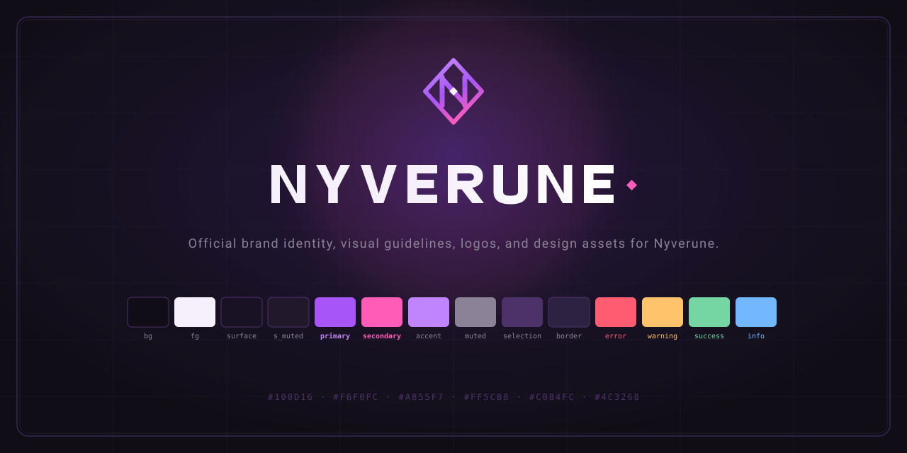

  

# Nyverune Brand

**Official brand identity, visual guidelines, logos, and design assets for Nyverune.**

---

Nyverune is a visual identity and design system crafted for modern **developer tools and infrastructure**. Rather than targeting a single environment, Nyverune powers an entire ecosystem:

- **Developer Tools**: Terminal utilities, shells, CLIs, TUIs, debuggers, identity managers (`nysh`).
- **Web Component Libraries & GUIs**: Component design systems, developer portals, dashboards, documentation engines.
- **Languages & Compilers**: Syntax highlight palettes, diagnostics, error formatters, language toolchains.
- **Operating Systems & Desktop Environments**: System themes, window managers (Wayland/Hyprland), desktop shells.
- **Hardware & Firmware**: Custom ergonomic split keyboards (`nyverune-corne`), microcontrollers, OLED displays.

---

## 1. Core Color Tokens (TrueColor / 24-bit RGB)

Nyverune provides 14 core semantic color tokens:

| Token | Hex | Preview | Role & Usage |
| :--- | :--- | :---: | :--- |
| `background` | `#100D16` |  | Obsidian base background canvas |
| `foreground` | `#F6F0FC` |  | Primary high-contrast reading text |
| `surface` | `#181224` |  | Elevated cards, panels, keycaps |
| `surface_muted` | `#21182B` |  | Recessed containers, inputs, codeblocks |
| `primary` | `#A855F7` |  | Signature Neon Violet, focus, primary CTAs |
| `secondary` | `#FF5CB8` |  | Dream Pink, selection marker `▸`, badges |
| `accent` | `#C084FC` |  | Luminous lilac, interactive keybind triggers |
| `muted` | `#8B8297` |  | Subtitles, secondary text, shell output |
| `selection` | `#4C3268` |  | Row selection background, dividers |
| `border` | `#2E2242` |  | Inactive borders, framing |
| `error` | `#FF5C72` |  | Destruction `✗`, auth failures, errors |
| `warning` | `#FFC36B` |  | Caution `!`, pending checks, diagnostics |
| `success` | `#75D6A3` |  | Validation `✓`, authenticated states |
| `info` | `#72B7FF` |  | Links, paths, hostnames, diagnostics |

---

## 2. Fallback Palette for Non-RGB Terminals (ANSI 16 / 256)

For environments without 24-bit TrueColor support (serial consoles, basic terminal emulators, microcontrollers):

| Token | ANSI 16 Color | Code (16) | Code (256) | Approximation |
| :--- | :--- | :---: | :---: | :--- |
| `background` | Black | `0` | `233` | `#121212` |
| `foreground` | Bright White | `15` | `255` | `#EEEEEE` |
| `surface` | Black | `0` | `234` | `#1C1C1C` |
| `surface_muted` | Bright Black | `8` | `235` | `#262626` |
| `primary` | Magenta | `5` | `135` | `#AF5FFF` |
| `secondary` | Bright Magenta | `13` | `205` | `#FF5FAF` |
| `accent` | Bright Cyan | `14` | `183` | `#D7AFFF` |
| `muted` | Bright Black | `8` | `245` | `#8A8A8A` |
| `selection` | Bright Black | `8` | `60` | `#5F5F87` |
| `border` | Bright Black | `8` | `238` | `#444444` |
| `error` | Red | `1` | `203` | `#FF5F5F` |
| `warning` | Yellow | `3` | `215` | `#FFAF5F` |
| `success` | Green | `2` | `114` | `#87D787` |
| `info` | Blue | `4` | `75` | `#5FAFFF` |

ANSI shell script ready to source: [`tokens/ansi/nyverune.sh`](tokens/ansi/nyverune.sh).

---

## 3. Token Formats (Copy & Paste)

All token files are generic and self-contained:

- **CSS Variables**: [`tokens/css/nyverune.css`](tokens/css/nyverune.css)
- **TOML**: [`tokens/toml/nyverune.toml`](tokens/toml/nyverune.toml) & [`tokens/toml/alacritty.toml`](tokens/toml/alacritty.toml)
- **Lua**: [`tokens/lua/nyverune.lua`](tokens/lua/nyverune.lua) & [`tokens/lua/wezterm.lua`](tokens/lua/wezterm.lua)
- **JSON**: [`tokens/json/nyverune.json`](tokens/json/nyverune.json) (includes RGB, HSL, and ANSI 16/256)
- **YAML**: [`tokens/yaml/nyverune.yaml`](tokens/yaml/nyverune.yaml)
- **SCSS**: [`tokens/scss/_nyverune.scss`](tokens/scss/_nyverune.scss)
- **Tailwind Preset**: [`tokens/tailwind/tailwind.preset.js`](tokens/tailwind/tailwind.preset.js)
- **ANSI Terminal Script**: [`tokens/ansi/nyverune.sh`](tokens/ansi/nyverune.sh)
- **Zellij Theme**: [`tokens/kdl/nyverune.kdl`](tokens/kdl/nyverune.kdl)

---

## 4. Official Design Assets & Logos

All vector assets are in [`assets/`](./assets/) and are unified around the canonical emblem design:

| Asset | File | Description |
| :--- | :--- | :--- |
| **Horizontal Logo** | [`assets/logos/nyverune-logo.svg`](assets/logos/nyverune-logo.svg) | Canonical emblem + wordmark |
| **Vertical Logo** | [`assets/logos/nyverune-logo-vertical.svg`](assets/logos/nyverune-logo-vertical.svg) | Centered stacked lockup |
| **Monochrome White** | [`assets/logos/nyverune-logo-white.svg`](assets/logos/nyverune-logo-white.svg) | Clean white vector logo |
| **Monochrome Dark** | [`assets/logos/nyverune-logo-dark.svg`](assets/logos/nyverune-logo-dark.svg) | Clean obsidian vector logo |
| **Emblem Icon** | [`assets/icons/nyverune-icon.svg`](assets/icons/nyverune-icon.svg) | Standalone cybernetic diamond rune icon |
| **Wordmark** | [`assets/wordmarks/nyverune-wordmark.svg`](assets/wordmarks/nyverune-wordmark.svg) | Vector geometric wordmark |
| **Banner** | [`assets/banners/nyverune-banner.svg`](assets/banners/nyverune-banner.svg) | 1280x640 social preview & repository card |
| **Favicon** | [`assets/favicons/favicon.svg`](assets/favicons/favicon.svg) | Canonical 64x64 vector icon |
| **Pixel OLED** | [`assets/oled/oled-logo-128x32.svg`](assets/oled/oled-logo-128x32.svg) | 128x32 pixel-art OLED logo |

---

## 5. Visual Guidelines & Component Recipes

Detailed design philosophy, component recipes (web components, TUIs, diagnostic dialogs), and the **Three Golden Rules** are documented in [**`GUIDELINES.md`**](GUIDELINES.md).

---

## License

Released under the [MIT License](LICENSE). Copyright © 2026 Nyverune.
